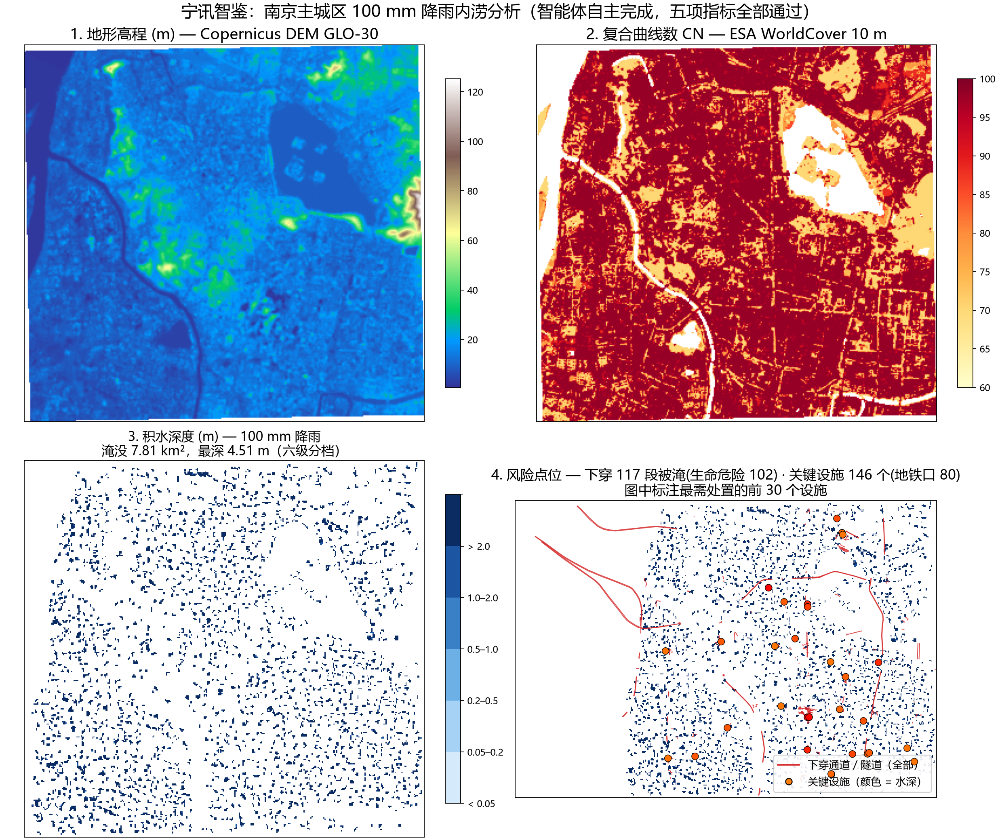
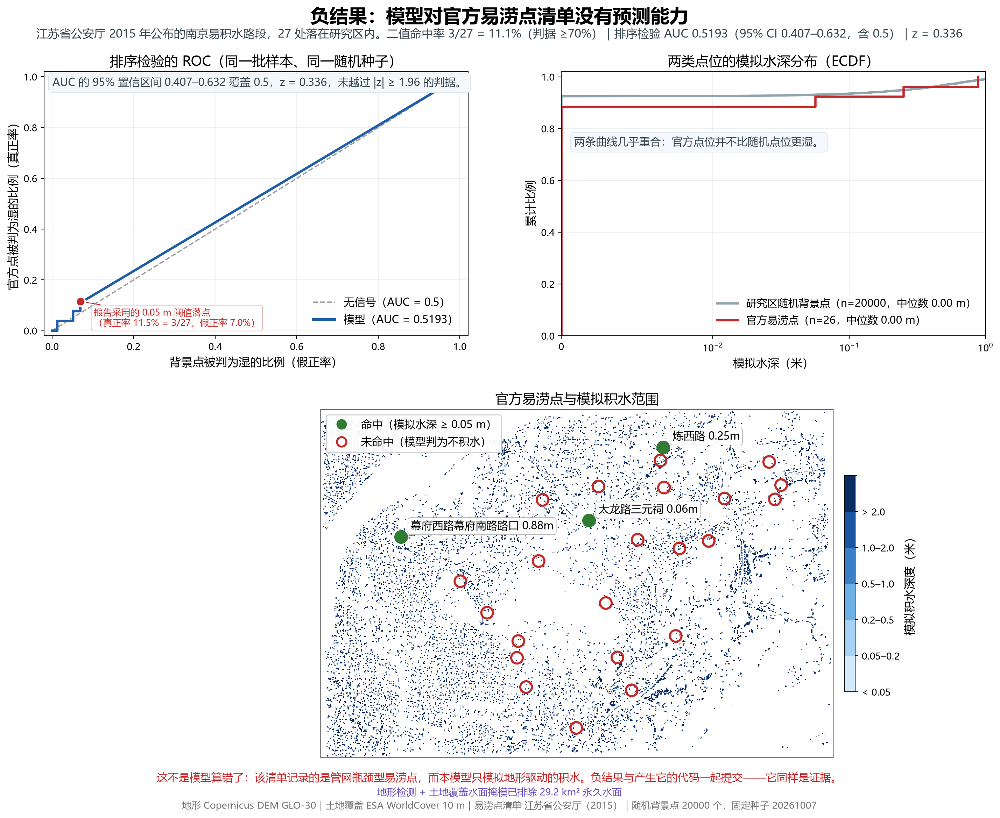
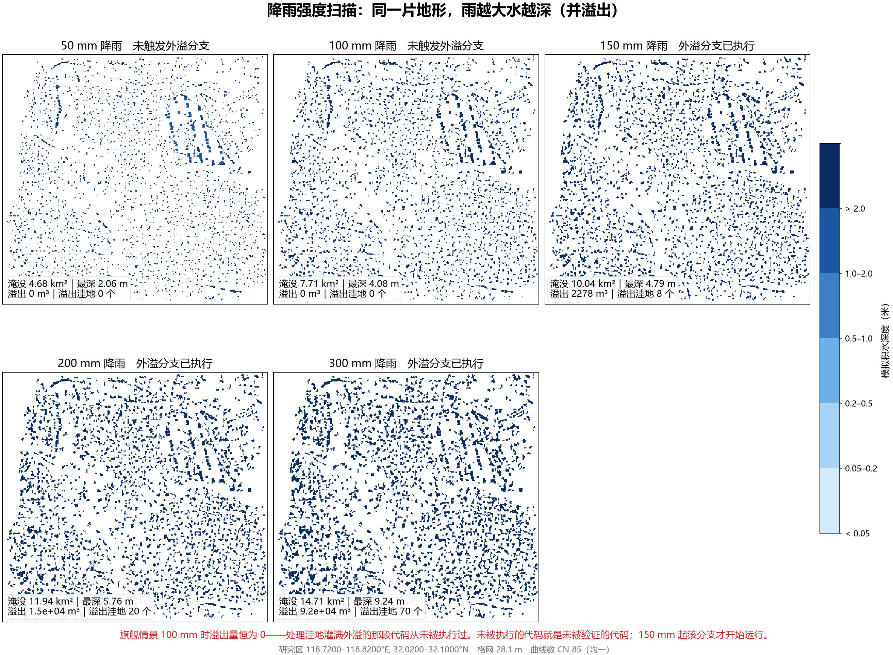

# 宁讯智鉴：城市内涝「感知—建模—验证」自主智能体

> 2026 年江苏省 AI+ 科学与工程创新实践黑客松（高校组 · 本科生组）
> 运行底座：**Agnes Harness（AGH）**　模型：**仅 Agnes 系列**
> 参考方向：工程仿真与优化（主）· AI 驱动科学发现（加选）

---

## 一句话

**给一个真实地点和一场真实降雨，智能体自己规划、自己调工具、自己算出内涝淹没范围，并且在没人盯着的情况下自己证明"这个结果是对的"——证明不了就自己找原因。**

我们不交示意图，我们交**能被人当面复算的结论**。

## 它回答什么问题

不是"生成一张好看的水深图"，而是三个能拿去做决策的问题：

1. 这场雨下下来，**哪些路会淹、淹多深**？
2. **多少栋建筑**受影响、受影响面积多大？
3. 这个结论**凭什么可信**？——每一项都有客观指标，任何一项不达标都会在报告里红字标出。

南京片区实测（76.3 km² 研究区，100 mm 降雨）：

| 结论               | 数值                                                         |
| ---------------- | ---------------------------------------------------------- |
| 积水面积             | 7.81 km²                                                   |
| **受影响下穿通道 / 隧道** | **117 / 420 段被淹**，其中**生命危险级（≥0.3 m）102 段**，其中**车行隧道 44 段** |
| **受影响关键设施**      | **146 / 292 个被淹**，其中**地铁口 80 个**                           |
| 受影响道路            | 1722 / 4751 条，淹没长度 4112 m                                  |
| 受影响建筑            | 1131 / 12080 栋（9.3%），建筑面积 58.3 万 m²                        |
| 积水最深处（适用域内）      | 4.51 m（该点已标记为需现场核验）                                        |

**最需要立刻处置的点位**（真实名称，来自 OpenStreetMap）：

| 类型       | 名称               | 水深         |
| -------- | ---------------- | ---------- |
| 学校       | **南京五十中**        | **2.55 m** |
| 地铁口      | **新街口 #2 / #13** | **2.47 m** |
| 地铁口      | 张府园 #4           | 2.23 m     |
| 幼儿园      | 小百灵幼儿园           | 2.15 m     |
| **车行下穿** | **黄家圩路**         | **2.06 m** |
| **长江隧道** | **南京定淮门长江隧道**    | 1.62 m     |
| 医院       | 四五四医院            | 1.86 m     |

> 为什么单列这两类：**下穿隧道会从两端灌满、没有逃生路线**（郑州 2021 京广路隧道），
> **地铁口进水则直接连通地下空间**。把它们混在"某条路湿了"的清单里，
> 等于把最要命的风险和最不要紧的风险一起报出去。
> 报告还额外把**车行隧道**从人行地下通道里拆出来——应急方案真正要封的是前者。



*一张图讲完链条：地形高程 → 复合曲线数 → 积水深度 → 风险点位。*
*由 `python scripts/make_story_figure.py` 生成。*

### 交互式报告：让评审自己动手核对

上面的图是**给人看**的；下面的 HTML 是**给人查**的。一个文件，双击就开，**断网也能用**
——底图预烘焙进文件（base64 内嵌），不引用任何 CDN、不请求任何瓦片。

```powershell
python -X utf8 scripts\make_report_html.py nanjing_final
python -X utf8 tests\verify_report_html.py nanjing_final
```

它能做四件静态图做不到的事：

| 能力 | 为什么重要 |
|---|---|
| **鼠标读点** | 任意位置直接读出水深与地面高程，不必再从色标上估 |
| **地形 / 水面剖面** | 在地图上点两个点，切出该线的地形高程与水面线，并单独标出 0.3 m 生命危险阈值——下穿隧道"从两端灌满"用一张剖面就讲清楚了 |
| **图层开关** | 水深、路网、下穿（被淹 / 未淹分色）、关键设施、需核验洼地可分别开关；420 段下穿里**哪 117 段真的被淹**一眼可见 |
| **指标可下钻** | 三项机器可判指标标出通过 / 未通过，并显示原始数值与它在 `report.json` 里的字段路径；**本页未包含的指标（D02 / D03 / 解析校核）也逐条列明**，避免"三个绿点"被误读成"全部通过" |

**两份数据只有一份来源**：页面上每个数字都从该次运行的 `report.json` 与 `depth.tif` 读，
不手工录入。下穿段与设施图层**用同一套 `floodkit.exposure` 函数**从缓存 OSM 数据重算
（报告只留前 30 条，而地图要画全），**重算结果与报告不一致时脚本直接拒绝生成**——
一次渲染器悄悄和报告说两套话，比没有渲染器更糟。

**离线与体积是被测出来的**，不是被声称的：`tests/verify_report_html.py` 会扫描页面里有没有
任何会发起网络请求的东西（`fetch` / `XMLHttpRequest` / `<link>` / `@import` / 外部 `src`），
把 `depth.tif` 重新编码一遍**逐字节**比对内嵌栅格，把页面内嵌的指标与磁盘上的报告**逐字段**对账，
并用页面内嵌的数据重算图层数量与报告核对。成品 **1.71 MB**（76 km² 研究区）／**6.06 MB**
（405 km² 的 `nanjing_wide`），单个文件预算 8 MB，超了脚本直接失败而不是悄悄产出。

> **失败指标不会被渲染器洗白**：验证脚本断言页面里的指标与 `report.json` **完全一致**，
> 包括 `nanjing_wide` 里那条未通过的 D02。一个把失败指标悄悄变绿的渲染器，
> 比没有渲染器更糟——这条断言就是防它的。

> **注意**：页面里的**中文字体走系统字体栈**，不内嵌 webfont——这是它在 Linux 评委机器上
> 仍然可读的原因。PNG 侧没有这个便利，所以 `floodkit.runio.configure_fonts()` 会在缺字体时
> **打印警告并按需切英文标签**，而不是静默渲染成一行行方框。

### 关于"图清不清晰"：两边都要顾

把图做清楚有两个**互相独立**的维度，只调其中一个没用：

| 维度 | 症状 | 处理 |
|---|---|---|
| **绝对像素** | 放大后发虚、打印发毛 | 报告级地图 2409×1891 → **2883×2256**；故事图 → 2475×2079；负结果图 → 2858×2339；降雨单帧 899×743 → **1489×1234**（原先整幅还不到 900 px，一放大就糊） |
| **文字占图幅的比例** | 缩到 1000 px 显示时中文标注只有 **8 px**，读不了 | 图幅 14.6→13.2 in 同时字号 +35%：同样缩到 1000 px，标注从 **8.3 px 升到 12.1 px** |

交互页面是第三种情况：PNG 是固定像素，而**页面可以无限放大**。底图原先按 5 px/格烘焙，
而缩放上限是 40 px/格——**8 倍上采样**，这才是"一缩放就糊"的来源。现在烘焙 8 px/格，
并把缩放上限锁在底图原生分辨率上（水深图层由原始分级码现绘，任何缩放都清晰）。

另外调了两处**看得见**的问题：水深最浅两档原本是 `#eef6fe` / `#d9ecff`，在 `#f7f7f5` 底图上
几乎等于"干"——而最浅那档（trace）正是让画出来的水面与标题对账的那一档，看不见就白加了；
现在换成从浅到深的六档可分辨色阶，地图、交互页、降雨扫描、故事图共用同一套。

### 打印件与矢量成果：给要拿去用的人

```powershell
python -X utf8 scripts\make_report_map.py nanjing_final              # PNG + PDF
python -X utf8 scripts\make_report_map.py nanjing_final --formats png,pdf,svg
python -X utf8 scripts\export_geojson.py nanjing_final                # 两个 GeoJSON
```

| 产物 | 给谁用 | 关键性质 |
|---|---|---|
| `_report_map.png` / `.pdf` / `.svg` | 报告、PPT、打印 | **版式与数据来源绑定**：图例在地图外不压数据；420 段下穿按**被淹 / 未淹分色**；模型自己标记的 104 个「需核验 / 适用域外」洼地单独出符号；右侧列出**最需处置的 6 段**，这张图脱离报告也能单独看 |
| `_report_map.pdf` | 印刷、放大 | 内嵌 5 个字体程序，**没有中文字体的机器也能正常显示** |
| `_report_map.svg` | 二次编辑 | 文字**全部转曲**，文件里 0 个 `<text>`、0 个 `font-family` 引用（约 4.5 MB，默认不生成） |
| `_ponding.geojson` | QGIS / ArcGIS / 空间分析 | 水深分级多边形，面积总和与报告**逐位对账** |
| `_exposure.geojson` | 同上 | 下穿段 420、设施 146、淹没道路 1722、受影响建筑 1131，按 `layer` 属性过滤 |

**两条纪律**：① 图上的每一个图层数量都与 `report.json` 对账，对不上就拒绝出图；
② 缺中文字体时**自动切英文标签并打印警告**，而不是静默渲染成一行行方框。

### 一次被查出来的输出不一致

把 GeoJSON 多边形面积与报告标题对账时发现：**报告标题的淹没面积统计所有有水的格子
（9890 个，7.81 km²），而当时每一张图都从 0.05 m 起画（9249 个，7.30 km²）——图比标题少画了 6.5%。**

差的 0.506 km² 全在 0–5 cm 那一档。修法是把这一档做成正式的第一个分级（`< 0.05 m`），
所有输出共用 `floodkit/runio.py` 里的一份定义；`tests/verify_geojson.py` 现在会把多边形面积
总和与报告对账，这类"标题和图不一致"不会再无声通过。细节见 [docs/LIMITATIONS.md](docs/LIMITATIONS.md)。

> **智能体要走的路径已彩排过**：`node tests/rehearse-agent-path.mjs` 用与智能体相同的参数
> 直接驱动插件（不调模型），逐项核对文档里的每个数字。**实测 23/23 通过**（含渲染交互页并真的打开它返回的网址）。

## 为什么可信：五项机器可判指标

**每一项都由程序判定，不达标就在报告里失败，而不是由我们口头保证。**

| 编号 | 指标 | 含义 | 阈值 | 实测 | 在哪里能看到 |
| ---- | ---- | ---- | ---- | ---- | ---- |
| D01 | 水量平衡 | `降雨 = 初损 + 持续下渗 + 蓄量 + 溢出 + 出流 + 残差` | ≤1% | **0.000000** | 报告 JSON `water_balance` |
| D01b | 栅格 vs 解算器 | 从**输出的栅格文件**重算蓄量，与解算器按洼地汇总的蓄量比对 | ≤1e-6 | **2.1e-16** | 报告 JSON `water_balance` |
| D02 | 官方易涝点核对 | 与江苏省公安厅公布的南京易涝点比对 | ≥70% | **11.1%（未通过）** | 报告 JSON `checkpoints`（需 `--checkpoints`） |
| D02b | 排序检验 | 官方点位是否比随机点位更湿（AUC + 置信区间） | 报告用 | **0.5193 ± 0.0573** | 报告 JSON `checkpoint_ranking` |
| D03 | 跨语言独立复算 | 同一套物理用 **JavaScript 从零重写**，比对水位与 SCS 各项 | 水位差 ≤0.05 m | **0.0 m** | **AGH 工具** `flood_crosslang_check`（不在报告 JSON 里） |
| D04 | 参数敏感性 | CN ±20% 时淹没面积必须**单调**且有界 | 单调且 ≤45% | **单调，30.0%** | 报告 JSON `sensitivity` |
| 解析校核 | 填洼 / 水位—库容反演 / SCS 闭式解 | 与解析解逐位比对 | 全过 | **5/5** | `python -m floodkit selftest` |
| 回归测试 | 每个修过的真 bug 锁一条 | 全过 | **31/31** | `python tests/test_floodkit.py` |
| 三类样例 | 正常 / 边界 / 失败 | 期望全部满足 | **8/8** | `python -m floodkit samples --cn-source landcover` |
| 插件契约测试 | AGH 工具契约 + 负向对照 | 全过 | **42/42** | `node agh-plugin/test-plugin.mjs` |
| 降雨强度扫描 | 50–300 mm 四个结构性断言 | 全过 | **4/4** | `python tests/rainfall_sweep.py` |

> **D03 不在报告 JSON 里**，它由 AGH 工具 `flood_crosslang_check` 在智能体的工具链内执行——
> 所以它**每跑一次都会重新校验**，而不是某人很久以前跑过一次的脚本。
> 该检查覆盖 **24 个 SCS 算例 + 10 个水位—库容算例**（含空洼地、恰好满库、超库容、
> 平底并列高程、单格、零库容），最差水位差 **8.9e-16 m**。
> 另有两道**负向对照**：故意改坏 Python 的答案，检查器必须报错——否则说明它已经不再检查任何东西。

> **D01b 与 D03 是两条最硬的证据。**
> D01b 拿最终交付给用户的那个栅格文件重新积分，去对撞解算器自己的账——任何"算得对但写错了"的错误都会暴露。
> D03 用**另一种语言**重写同一套数值算法（SCS-CN、水位—库容反演、洼地水位求解），
> 原计划用 MATLAB，但本机 MATLAB 许可证已过期（MathWorks 错误 10），
> 改为 JavaScript 实现——**它跑在智能体自己的工具链里，所以每一份结果都能被当场复算，而不是只跑过一次的脚本。**

## 快速开始

```powershell
# 1. 环境（自动找 Python、装依赖、写配置、复制 AGH 插件）
pwsh -File scripts\setup.ps1 -AghRepo <你的 agnes-harness 路径>

# 2. 解析自检（不需联网）
python -X utf8 -m floodkit selftest

# 3. 三类测试样例 + 证据包
python -X utf8 -m floodkit samples --bounds 118.72 32.02 118.82 32.10 --cn-source landcover

# 4. 完整事件（含 OSM 承灾体）
python -X utf8 -m floodkit run --bounds 118.72 32.02 118.82 32.10 `
       --rain-mm 100 --cn 85 --cn-source landcover --tag demo --exposure

# 5. 回归测试
python tests\test_floodkit.py
```

产物落在 `data/runs/<tag>/`（深度栅格 GeoTIFF、地图 PNG、JSON 报告、Markdown 报告）
与 `data/evidence/samples/`（三类样例汇总 `SUMMARY.md`）。

## 系统架构

```
       用户任务书（地点 + 降雨情景 + 决策问题）
                    │
     ┌──────────────▼──────────────┐
     │  AGH（智能体运行与执行底座） │  规划 → 调工具 → 读反馈 → 验证 → 重试
     └──────────────┬──────────────┘
                    │  后端工具插件（agh-plugin/）
   ┌────────────────┼──────────────────────────┐
   ▼                ▼                          ▼
flood_fetch_dem  flood_run_event        flood_verify_report
                 flood_selftest         flood_publish_report
                 flood_resolve_place
                 flood_weather
                 flood_crosslang_check
   │                │                          │
   └────────┬───────┴──────────────┬───────────┘
            ▼                      ▼
   floodkit（Python 科学内核）   独立验证器（JavaScript 重算）
```

**设计原则：模型负责规划与诊断，正确性由确定性工具与验证器保证。**
`agnes-3.0-flash` 免费且够用，但我们不依赖模型"算得对"，而是让它"调度得对、诊断得对"。

### 科学内核

```
DEM(GLO-30 30m) → 度量投影(UTM 50N，因为地理坐标系下格子面积随纬度变化)
→ 质量门(缺失/量纲/坐标系/量程) → 优先淹没填洼 → D8 汇流 → 洼地单元
→ 土地覆盖(ESA WorldCover 10m) → 复合曲线数 CN
→ SCS-CN 产流(P = Ia + F + Q) → 各单元水位—库容曲线求平衡水位
→ 逐格淹没深度 → 五项验证 → OSM 承灾体叠加 → 决策清单
```

## AGH 集成

插件 `agh-plugin/` 注册 8 个工具，**契约测试 42/42 通过**（含两个负向对照）：

| 工具                      | 作用                              | 副作用          |
| ----------------------- | ------------------------------- | ------------ |
| `flood_selftest`        | 解析校核，调用前先验算内核                   | 只读           |
| `flood_resolve_place`   | **地名 → 研究区范围**（只认南京，认不出就报错）    | 只读           |
| `flood_weather`         | **查预报**，以三个独立模式的区间形式给出        | 联网 + 写缓存，免审批 |
| `flood_fetch_dem`       | 拉取研究区 DEM 瓦片                    | 联网 + 写缓存，需审批 |
| `flood_run_event`       | 跑一次完整降雨事件                       | 写产物，需审批      |
| `flood_publish_report`  | **渲染交互式报告并给出网址**，用户自己打开看        | 写派生页面，免审批    |
| `flood_publish_report`  | **渲染交互式报告并给出网址**，供用户自己查看       | 写派生页面，免审批    |
| `flood_verify_report`   | **用 JavaScript 独立重算**报告中的水量平衡   | 只读           |
| `flood_crosslang_check` | **跨语言独立复算** SCS-CN、水位—库容反演与洼地水位 | 只读           |

**前两个工具是为了让智能体能质疑"输入"，而不只是质疑"输出"。**
`flood_resolve_place` 阻止它凭空编一个研究区；`flood_weather` 让它发现
用户说的雨量和预报不符。算得对不对从来不是弱点，**问题是前提对不对**。

**两条硬性范围**（都写在代码里，超出即拒绝，不猜测）：

| 范围 | 限制 | 理由 |
|---|---|---|
| **空间** | **只认南京** | 曲线数、高程包络、承灾体图层都只在南京验证过 |
| **时间** | **未来 15 天以内** | 15 天正好落在模式能力（16 天）之内，所以只有"超出项目范围"一种拒绝理由 |

**安装方式（必须走 Web 工作台）**

AGH 的 `confirmPackageInstall` 要求 stdin/stdout 都是 TTY，否则一律判定为"未同意"并取消
（源码 INV-33：未回答的提问永不视为同意）。这是官方的安全设计，不是缺陷，但也意味着
**CLI 无法脚本化安装**。且 `file:` 包源被 schema 限制为 `file:./` 开头、不允许 `..`，
所以插件必须先复制进 AGH 仓库目录。

> **更硬的一条限制**：`agh package trust <id> <integrity> <capabilityHash>` 需要 capability hash，
> 而**命令行上没有任何命令会打印它**——`runPackageCommand` 的 `inspect` 分支无条件调用
> `formatPreview()`（忽略全局 `--json`），那段文本只有 id、integrity、contributions、warnings。
> 工作台从 daemon 响应里拿到这个 hash 再让你确认，**这正是 `trust` 要做的核对**；
> 由脚本跳过它，等于假装核对过了。所以安装**只能**在工作台完成。
>
> `安装插件.cmd` 因此做的是**同步 + 预检**：把文件复制到位、让 AGH 解析这个包、
> 打印出 id / integrity / warnings / 应注册的工具数，供你与工作台显示的哈希**对照**。
> 界面显示的 integrity 与它打印的不一致，就**不要**确认。

先跑一次 `安装插件.cmd`，然后：

```
1. 双击 启动AGH.cmd
2. 打开工作台 → 设置 → 插件管理
3. 源填 file:./flood-tools → 核对来源、完整性哈希、能力清单
   （界面显示的 integrity 应与预检打印的完全一致）
4. 确认安装 → 信任 → 启用
5. 工具列表中应出现上述 8 个工具
```

安装后由 AGH 的轨迹视图记录模型调用、工具调用与审批，即为提交所需的 **AGH 执行记录**。

### 一句话提问，拿到结论和网址

装好之后，在工作台里直接问：

> 南京明天中午 12 点下 100 毫米的雨，会发生什么？

智能体自己走完四步，**最后把可点击的网址给你**：

| 步骤 | 它做什么 | 为什么 |
|---|---|---|
| 1 | `flood_weather` 查明天中午的预报 | **先质疑前提**：如果三个模式给出的是 5–20 mm，它会告诉你"你说的 100 mm 与预报不符"，而不是闷头按 100 mm 算 |
| 2 | `flood_resolve_place` 把"南京"转成研究区 | 认不出就报错，不猜范围 |
| 3 | `flood_run_event` 跑事件 | 返回结论与全部细节（淹没面积、最深、下穿段、地铁口、道路、建筑） |
| 4 | `flood_publish_report` 渲染并给网址 | `http://127.0.0.1:<port>/<tag>/<tag>_report.html` |

**为什么给的是 http 而不是文件路径**：工作台跑在浏览器里，页面**不能**跳到 `file://`——
只丢一个路径给用户，等于让他自己去找。所以第 4 步起了一个**只读的本地预览服务**：

- 只绑 `127.0.0.1`，端口由系统分配，不对外、不会撞上工作台；
- 服务范围限定在 `data/runs/`，并对解析后的路径做边界检查（请求 `%2e%2e%2f` 越界一律 403）；
- 随 harness 进程存在，不留下孤儿进程；
- 同一个网址下还能直接打开 `_report_map.png` / `.pdf` / `_ponding.geojson` 等兄弟产物。

这条链路有彩排兜底：`node tests/rehearse-agent-path.mjs` 会真的渲染、真的 **fetch 那个网址**，
并核对页面里的数字与文档一致（**23/23**）。

## 三类测试样例

`python -m floodkit samples --cn-source landcover` —— 每个案例**先声明必须发生什么**，
runner 断言它，不符即整体失败。**样例跑在与发布配置一致的设置上**（土地覆盖 CN），
不是跑在一个更宽松的简化配置上。

| 案例                                  | 类型  | 期望               | 实测  |
| ----------------------------------- | --- | ---------------- | --- |
| `normal_standard_event`             | 正常  | 指标全过、出栅格         | ✅   |
| `boundary_zero_rain`                | 边界  | 降级、零淹没、仍能评估      | ✅   |
| `boundary_dem_holes`                | 边界  | 空洞被报告并当排水口，不造假积水 | ✅   |
| `boundary_flat_terrain`             | 边界  | 平坦被标出，不假装有意义     | ✅   |
| `failure_missing_crs`               | 失败  | 拒绝，不留栅格          | ✅   |
| `failure_imperial_units`            | 失败  | 拒绝（英尺当米）         | ✅   |
| `failure_corrupt_rainfall`          | 失败  | 建模前拒绝            | ✅   |
| `failure_curve_number_out_of_range` | 失败  | CN 150 无物理意义，拒绝  | ✅   |

## 变异测试：证明测试套件真的会失败

一个通过的测试套件**不能证明它测到了任何东西**。本项目反复踩的坑就是这个：
数据结构一变，测试还在"通过"，但其实已经什么都不检查了。

所以我不再靠读测试来判断，而是**故意把源码改坏，看测试会不会抓**：
`python tests/mutation_check.py` 会把 15 种破坏注入源码副本，跑一遍测试，再还原。

| 注入的破坏 | 结果 |
|---|---|
| 保留公式里忘减 254（`S = 25400/CN`） | ✅ 抓到 |
| 洼地满了却返回坑底水位 | ✅ 抓到 |
| 空洼地却返回溢出水位 | ✅ 抓到 |
| 曝光分析用正向仿射变换代替逆变换（**曾经真实上线的 bug**） | ✅ 抓到 |
| 关掉高程包络检查 | ✅ 抓到 |
| 库容曲线改用**填洼面**高程（bug #3，曾让库容≈0） | ✅ 抓到 |
| 只把"深度 > 报告阈值"的洼地算作有蓄水 | ✅ 抓到 |
| 把水铺到整个汇水区而非填洼面（bug #13，曾造成 2.5% 水量不平衡） | ✅ 抓到 |
| 道路采样按"米"加密而函数要"像素"（bug #12） | ✅ 抓到 |
| CN 不再钳制到 1..100 | ✅ 抓到 |
| 只改文档字符串（对照组，**不应**被抓到） | ✅ 正确地没抓到 |

**10/10 全部抓到，0 个幸存者。**

这次的第一次运行**抓到 2 个幸存者**——也就是说当时的测试套件抓不到"忘减 254"和
"CN 不钳制"。根因是 SCS 恒等式测试**用被测函数自己算期望值**（自证），
公式一错两边一起偏移。修法是用**物理锚点**钉住常数：`CN=100 ⇒ S=0`
（不透水面没有滞留），任何实现都伪造不了。

## 降雨强度扫描：把没跑过的代码跑起来

旗舰情景是 100 mm。跑一次扫描才发现：**100 mm 时"洼地灌满外溢"的溢出量恒为 0，
也就是处理溢出的那段代码从未被执行过。** 未被执行的代码路径就是未验证的路径。

`python tests/rainfall_sweep.py` 的结果：

| 降雨 | D01 | 淹没 km² | 溢出 m³ | 溢出洼地数 | 最大水深 |
|---|---|---|---|---|---|
| 50 mm | 5e-15 | 4.68 | 0 | 0 | 2.06 m |
| 100 mm | 1e-14 | 7.71 | 0 | 0 | 4.08 m |
| 150 mm | 3e-14 | 10.04 | 2,278 | 8 | 4.79 m |
| 200 mm | 2e-14 | 11.94 | 14,901 | 20 | 5.76 m |
| 300 mm | 3e-14 | 14.71 | **92,003** | **70** | 9.24 m |

四条结构性断言全部通过：每个情景都跑完、水量平衡在每个强度下都成立（机器精度）、
淹没面积随降雨单调不减、**溢出分支确实被执行**。溢出分支另有一条回归测试锁定。

## 交付物自检：从评委的视角验一遍

工作区里缓存、依赖、探索文件都在，但**评委只打开 ZIP**。所以打包后有一步专门的复核：

```bash
python tests/verify_package.py
```

它把 ZIP 解压到临时目录，在**那里**跑解析校核、回归测试与文档一致性，并确认排除项（`_agh_src` 约 1GB、`_mutation`、`.pylibs`、`data/tmp`）没有泄漏进包。

**实测结果**：排除项未泄漏 · 解压后回归 31/31 · 文档一致性通过。

## 可复现性：我们实测过"别人拿到这份代码能不能跑"

不是声称可复现，而是**做了一次干净副本测试**：把提交范围内的源码（60 个文件）复制到一个全新目录，
在那里重新跑全部验证，缓存指向原目录（模拟"依赖已装好、数据已就绪"的正常情形）。

| 在干净副本中执行 | 结果 |
|---|---|
| `python -m floodkit selftest` | ✅ ok |
| `python tests/test_floodkit.py` | ✅ **31/31** |
| `python -m floodkit run ... --exposure` | ✅ outcome ok，**数字与原始运行完全一致** |
| `python -m floodkit samples --cn-source landcover` | ✅ **8/8** |

干净副本给出的数字：淹没 7.81 km²、D01 0.000000、D01b 2.1e-16、D04 0.3004、
道路 1722/4751、下穿 117 段、关键设施 146/292、地铁口 80 个——**与原目录逐项相同**。

### 冷启动也实测过

"别人拿到代码能不能跑"还有一半是**数据从哪来**。所以另外做了一次**三个缓存目录全空**的运行：

| 项 | 实测 |
|---|---|
| 耗时 | **107 秒**（含下载） |
| 下载量 | Copernicus DEM 46.5 MB + ESA WorldCover 129.9 MB + OSM 9.2 MB ≈ **186 MB** |
| 结果 | **与缓存运行逐项完全相同**（连 D01 = 2.440531414541089e-16 都一样） |

也就是说，**缓存只影响速度，不影响结果**——这一点是被证明的，不是被假设的。

另外已确认：提交范围内**没有任何硬编码绝对路径**，全部通过 `__file__` 定位自身。

## 已知局限

完整清单见 [docs/LIMITATIONS.md](docs/LIMITATIONS.md)（8 项）。最重要的一条：

> **排水管网未建模。** 模型假设水只能靠地形消失，不考虑雨水口、管渠、泵站，
> 因此**倾向于高估**积水范围。这是当前最大的简化，也是下一步最有价值的增强。

我们把它写出来，是因为一个不敢说自己边界的模型，等于在偷偷替用户做假设。

**更关键的一条（我们实测过）**：模型对 [江苏省公安厅 2015 年公布的南京 32 处易积水路段](https://gat.jiangsu.gov.cn/art/2015/7/20/art_6373_6620598.html)
**没有任何预测能力**——二值命中率 **11.1%（3/27，阈值 70%）**，排序检验 **AUC 0.5193 ± 0.0573**
（95% CI 0.407–0.632 含 0.5，z = 0.336，**与"完全无信号"无法区分**）。
原因不是模型算错了，而是那份清单记录的是**管网瓶颈型**易涝点，而本模型只模拟**地形驱动**的积水。
这个负结果写在 [docs/LIMITATIONS.md](docs/LIMITATIONS.md) 第六节，**我们没有把它删掉**。

> 早期版本用"道路几何中心"匹配这 27 个点，得到命中率 **7.4%**、AUC **0.4991**；改成求两条路的
> 实际交点后（点位最多移动约 3.5 km）才是上面的 **11.1% / 0.5193**。两个数都留在
> [docs/LIMITATIONS.md](docs/LIMITATIONS.md) 的对照表里——**负结果本身也要能被复算，包括我们自己改过的部分。**

### 把负结果画出来

```powershell
python -X utf8 scripts\make_negative_result_figure.py nanjing_wide
```



三个面板各自回答一句"是不是阈值设错了"：

| 面板 | 回答 |
|---|---|
| **ROC** | 把判据换成任何阈值，这条曲线都到不了 70% —— 图上标出了报告采用的 0.05 m 阈值落点（真正率 11.5%、假正率 7.0%） |
| **ECDF** | 官方点位与随机背景点的水深分布**几乎重合**：官方点位并不比随机点位更湿 |
| **地图** | 27 个点位逐一点出，绿色 3 个命中（带真实路段名），红色 24 个未命中 |

**这张图是重跑那个事件画出来的**，不是照着报告的数字画的：报告的 AUC 依赖该次运行用的水面掩模
（地形检测 ∪ 土地覆盖）和请求范围，而度量栅格回推不出请求范围。脚本在画任何东西之前会断言
**重算的命中率与 AUC 等于报告里的值**，并且**图中曲线积分出的 AUC 必须等于排序统计算出的 AUC**
（两个独立算法，同一个数）——实测两者都是 `0.519270192308`。

> 顺带补上了一个缺口：报告 JSON 现在记录 `run_config`（请求范围、雨量、CN 来源、包络、检查点清单）。
> 在此之前，请求范围是不可恢复的——这正是"重算一遍拿到不同输入"的根源。

### 降雨强度动画：把"没跑过的代码"演出来

```powershell
python -X utf8 scripts\make_rainfall_animation.py
```



产物：`data/evidence/` 下的 `rainfall_animation.gif`（5 帧，最后一帧停留 4.2 秒）、
`rainfall_animation.mp4`、`rainfall_smallmultiples.png`、`rainfall_animation.json`。

**它讲的是测试套件发现的那件事**：旗舰情景 100 mm 时溢出量恒为 0 —— 处理洼地灌满外溢的那段代码
**从未被执行过**。150 mm 起该分支才第一次运行。5 个面板共用同一套色标与范围，所以颜色在不同面板里
是同一个意思。脚本在出图前会把每个数字与**独立入口产出**的 `rainfall_sweep.json` 对账，不一致就拒绝生成。

> **一句话适用范围：本模型回答"地形上哪里会存水、存多深"，不回答"实际这场雨哪里会淹"。**
> 它适合做内涝风险普查与疑点筛查，**不适合**作为防洪调度或预警的唯一依据。

> **评委/评审：请先看 [docs/JUDGE_SUMMARY.md](docs/JUDGE_SUMMARY.md)** —— 一页纸，三分钟读完，每一行都指向可自行核对的证据。

## 文档索引

| 文档                                                     | 用途                                       |
| ------------------------------------------------------ | ---------------------------------------- |
| [docs/PUBLIC_POST_ZHIHU.md](docs/PUBLIC_POST_ZHIHU.md) | **知乎发布版**：纯文本排版，可直接粘贴，标好插图位置 |
| [docs/PUBLIC_POST.md](docs/PUBLIC_POST.md) | **公开内容成稿**：可直接发布的文章（含标题候选、配图建议、发布后清单） |
| [docs/SUBMISSION_RUNBOOK.md](docs/SUBMISSION_RUNBOOK.md) | **提交日运行手册**：从报名到打包的逐步命令、期望结果与故障排查 |
| [docs/DEFENSE_QA.md](docs/DEFENSE_QA.md) | **评审问辩准备**：13 个刁钻问题的一句话回答 + 证据 + 不要说的话 |
| [docs/HANDOVER.md](docs/HANDOVER.md) | **交接说明**：当前状态、剩余两项为何需要 Key、拿到 Key 后的 90 分钟最短路径 |
| [docs/JUDGE_SUMMARY.md](docs/JUDGE_SUMMARY.md) | **评审速览**：一页纸，三分钟读完，指向全部可核对证据 |
| [docs/LIMITATIONS.md](docs/LIMITATIONS.md)             | **先读这份**：我们证明了什么 / 没证明什么 + 已知局限 + D02 负结果 |
| [docs/SUBMISSION_PACKET.md](docs/SUBMISSION_PACKET.md) | **提交表单每个字段的现成文字**（作品简介、技术信息、成员声明、公开内容草稿） |
| [docs/DEMO_BRIEF.md](docs/DEMO_BRIEF.md)               | 演示任务书提示词 + 故障注入剧本 + 3 分 30 秒视频分镜         |
| [docs/PLAN.md](docs/PLAN.md)                           | 项目计划、里程碑、13 个已修复 bug 的完整记录               |
| [docs/SUBMISSION.md](docs/SUBMISSION.md)               | 官方报名与提交规则整理（含两个死线）                       |

## 目录结构

**六个文件夹，按"做什么的"分组。** 想读代码的话，按 ① → ② 的顺序看。

```
floodkit/            ① 核心计算代码（Python，纯计算，无界面依赖）
  dem_source.py      DEM 瓦片发现、下载与缓存
  places.py          地名 → 研究区范围（只认南京，认不出不猜）
  weather.py         预报降雨（多模式区间 + 15 天范围限制）
  quality.py         输入质量门（不达标就拒绝出图）
  terrain.py         填洼、洼地划分、D8 汇流、水位—库容反演   ← 核心
  landcover.py       ESA WorldCover 10m → 复合曲线数 CN
  hydro.py           SCS-CN 产流下渗、洼地水位平衡、全域水量平衡
  scenario.py        降雨情景定义
  exposure.py        OSM 承灾体分析（道路/建筑/下穿隧道/地铁口/学校/医院）
  runio.py           读一次已完成的 run：栅格、范围、OSM 缓存选择、分级定义  ← 输出的唯一来源
  pipeline.py        端到端编排与报告生成
  cli.py             命令行入口（全部输出 JSON，便于 AGH 解析）
  samples.py         三类测试样例（正常 / 边界 / 失败）
  __init__.py  __main__.py    包入口

agh-plugin/          ② AGH 工具插件（4 个文件）
  index.mjs          向 AGH 注册 8 个工具
  verify-core.mjs    JavaScript 独立实现的数值内核（跨语言验证）
  test-plugin.mjs    契约测试 33 项（含 2 道负向对照）
  package.json       插件清单

tests/               ③ 测试与自检（12 个文件）
  test_floodkit.py           回归测试 28 条
  mutation_check.py          变异测试：故意改坏源码，看测试会不会抓
  rainfall_sweep.py          降雨强度扫描（50–300 mm）
  check_doc_consistency.py   文档数字与报告是否一致
  check_exposure_refactor.py 承灾体重构后每个数字是否逐位不变
  verify_package.py          提交包体自检（解压到临时目录再跑一遍）
  verify_report_html.py      交互式报告自检（离线性 / 栅格逐字节 / 分级查表 / 图层对账）
  verify_map_outputs.py      地图产物自检（字体覆盖 / PDF 内嵌字体 / SVG 文字转曲）
  verify_geojson.py          矢量成果自检（面积与报告对账 / 坐标范围 / 要素数量）
  verify_evidence_figures.py 证据图自检（负结果 AUC 逐位对账 / 扫描动画单调性与外溢分支）
  rehearse-agent-path.mjs    演示彩排（不调模型，直接驱动插件）
  make_verify_fixture.py     生成跨语言验证用的夹具

scripts/             ④ 环境与工具脚本（13 个文件）
  setup.ps1                  一键环境准备（找 Python、装依赖、写配置）
  package-submission.ps1     打包成提交 ZIP
  install-plugin.mjs         同步插件到 AGH 并安装
  rebuild_outputs.py         一条命令重建全部产物并自检（新机器 / 清理过 data/runs 之后用）
  make_story_figure.py       生成四联故事图
  make_report_map.py         生成报告级风险地图（PNG / PDF / 可选 SVG）
  make_report_html.py        生成单文件离线交互式报告（HTML）
  export_geojson.py          导出水深多边形与承灾体矢量（GeoJSON）
  make_negative_result_figure.py  生成负结果图（ROC / 分布 / 点位，重跑事件以精确复现）
  make_rainfall_animation.py 生成降雨强度动画（GIF / MP4）与多情景小倍数图
  build_checkpoints.py       整理官方易涝点清单
  make_bad_dem.py            生成故意做坏的 DEM（异常处理演示用）
  hackathon_text.txt         比赛通知的文字提取

docs/                ⑤ 文档（11 份，按读者分：评委 / 自己 / 填表）
data/                ⑥ 数据与产物
  runs/              每次运行的产物（报告 JSON/MD、深度栅格、地图、点位图、交互式 HTML）
  evidence/samples/  三类测试样例的完整证据包
  fixtures/          故意做坏的输入 + 跨语言验证夹具
  checkpoints/       官方易涝点清单（含来源与匹配记录）
  dem/ landcover/ osm/   数据缓存（不进提交包）

README.md            项目入口说明
启动AGH.cmd           双击启动 AGH（内含 FLOODKIT_ROOT 环境变量）
安装插件.cmd          双击安装 flood 插件到 AGH
```

**记忆点**：`floodkit/` 是"怎么算的"，`agh-plugin/` 是"AI 怎么用它"，
`tests/` 是"怎么证明它没算错"，`scripts/` 是"怎么装和怎么打包"，
`docs/` 是"给人看的"，`data/` 是"算出来的结果和证据"。

## 数据来源与许可

| 数据    | 来源                             | 许可                 |
| ----- | ------------------------------ | ------------------ |
| 地形    | Copernicus DEM GLO-30（AWS 公开桶） | 免费开放               |
| 土地覆盖  | ESA WorldCover 10m v200（2021）  | CC BY 4.0          |
| 路网与建筑 | OpenStreetMap（Overpass API）    | ODbL，需署名           |
| 情景降雨  | 情景设定值（用户给定）                     | **非官方设计暴雨**，报告中已标注 |
| **预报降雨** | **Open-Meteo**（聚合 ECMWF IFS / NOAA GFS / DWD ICON 三个模式） | 免费非商业，**需署名**（CC BY 4.0） |
| 预报降雨（可选第二源） | 和风天气 QWeather（默认**未启用**，需自备 Key） | 按其服务条款 |

### 预报接口说明

**默认使用 Open-Meteo**，不需要注册、不需要 Key：

```
https://api.open-meteo.com/v1/forecast
  ?latitude=32.0617&longitude=118.7778
  &hourly=precipitation
  &models=ecmwf_ifs025,gfs_seamless,icon_seamless
  &forecast_days=16&past_days=1&timezone=Asia/Shanghai
```

**一次请求三个来自不同气象中心的模式**，取三者差异作为**预报区间**——
这是真实的数据离散度，不是人为设定的 ± 误差。

| 模式 | 机构 |
|---|---|
| `ecmwf_ifs025` | 欧洲中期天气预报中心 |
| `gfs_seamless` | 美国国家气象局 |
| `icon_seamless` | 德国气象局 |

**为什么必须用区间而不是单值**：24 小时前的降雨预报误差可能很大，
报"45 mm"是假装精确；报"35–60 mm，来自三个模式的差异"才是诚实。

**响应缓存**在 `data/weather/`（TTL 30 分钟），**不进提交包**（属派生缓存）。

**和风天气为可选的第二意见**，在 `启动AGH.cmd` 里取消注释并填入
`QWEATHER_KEY` 与 `QWEATHER_HOST` 即生效；免费版小时预报仅覆盖约 24 小时，
因此只用于临近时段交叉核对，**超出部分仍由 Open-Meteo 提供**。

## 独立完成声明

本作品由参赛队伍成员在赛事期间独立完成。第三方组件为上述公开数据集，
已在报告中逐项标注来源与使用方式；AGH 为赛事指定运行底座，沿用其开源版本。
