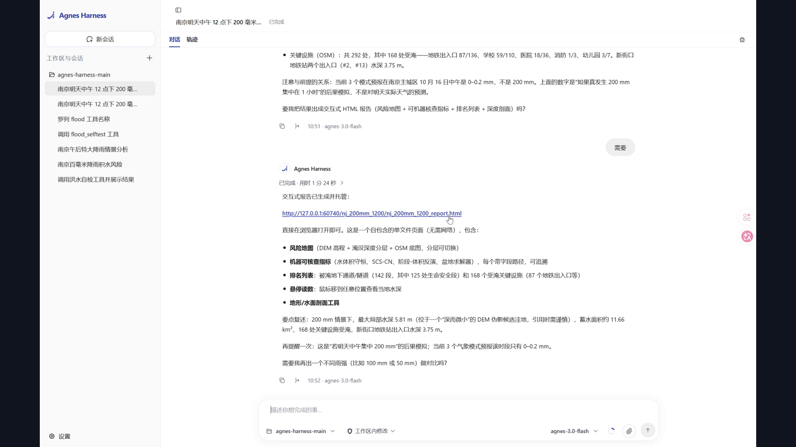

# Ningxun Zhijian — an urban-flooding agent that proves its own answer

[中文版](README.zh-CN.md) · [Architecture](docs/ARCHITECTURE.md) · [Integration standard](docs/INTEGRATION.md) · [Limitations](docs/LIMITATIONS.md)

> **Give it a real place and a real rainfall event. It plans the computation, calls
> the tools itself, works out where water collects and how deep it gets — and then,
> with nobody watching, proves the result is right. When it cannot prove that, it
> says so.**

No illustrative diagrams. Only conclusions a third party can recompute on the spot.

Built for the 2026 Jiangsu Province AI+ Science & Engineering Hackathon
(undergraduate group, entry **U247**), where it advanced to the finals. Runs on
Agnes Harness; the model is `agnes-3.0-flash`.

---

## 1. What it is

Urban flooding analysis usually delivers a picture. A picture is easy to publish
and impossible to check. This project delivers the **computation instead**: a
metric grid, a mass balance that closes, a depth raster, and a list of named places
that will be affected — every figure traceable to a JSON file and recomputable by a
second implementation written in a different language.

Three questions, because these are the ones a decision can be made from:

1. Which roads will flood, and **how deep**?
2. How many **buildings** are affected, and over what area?
3. **Why should anyone believe this?** — every indicator is machine-judged, and one
   that fails is printed in red instead of being quietly dropped.

### Results — Nanjing, 100 mm event over a 76.3 km² study area

| Quantity | Value |
|---|---|
| Ponded area | **7.81 km²** |
| Underpasses / tunnel sections flooded | **117 / 420**, of which **102 are life-safety grade (≥ 0.3 m)** and **44 are vehicle tunnels** |
| Critical facilities flooded | **146 / 292**, including **80 subway entrances** |
| Roads affected | **1722 / 4751** |
| Buildings affected | **1131 / 12080** (9.3 %) |
| Deepest cell in the valid domain | 4.51 m — flagged for on-site verification |

The points that need attention first (real names, from OpenStreetMap): **Nanjing
No. 50 Middle School 2.55 m**, **Xinjiekou subway entrances #2 / #13 2.47 m**,
Zhangfuyuan #4 2.23 m, Xiaobailing Kindergarten 2.15 m, **Huangjiawei Road
underpass 2.06 m**, **Dinghuaimen Yangtze Crossing 1.62 m**.

Underpasses and subway entrances are listed separately on purpose: an underpass
fills from both ends and has no escape route, and a subway entrance opens directly
into underground space. Reporting them inside "some roads are wet" would bury the
most lethal risk among the least urgent ones.


*Terrain → composite curve number → ponding depth → risk points, in one figure.
Generated by `python scripts/make_story_figure.py`.*

---

## 2. Demo video

[](data/evidence/demo/ningxun-zhijian-demo.mp4)

| | |
|---|---|
| **In this repository** | [`data/evidence/demo/ningxun-zhijian-demo.mp4`](data/evidence/demo/ningxun-zhijian-demo.mp4) — 4 min 48 s, 1920×1080, 17.9 MB |
| **Online** | <https://zhuanlan.zhihu.com/p/2093818060092216658> (embedded in the published article) |

Everything in the video comes from a live run — nothing is pre-recorded or
spliced. What to watch for:

| Time | What happens |
|---|---|
| 0:07 | The session opens on the Agnes Harness workbench |
| ≈ 0:24 | The question is typed: *"Nanjing, 200 mm of rain at noon tomorrow — what happens?"* |
| ≈ 0:40–2:30 | The agent plans, then calls the tools one by one (`flood_weather` → `flood_resolve_place` → `flood_run_event` → `flood_verify_report` → `flood_crosslang_check`), each call expandable in the transcript |
| ≈ 2:33 | The full answer, including the agent pointing out that the three forecast models predict **0–0.2 mm**, not 200 mm, so the figures describe a *hypothetical* event |
| ≈ 3:25 | The interactive report opens in the browser |
| 3:35 | A DEM with the wrong units is supplied — **the run is rejected and no raster is produced** |
| ≈ 4:11 | The five indicators and the published negative result (AUC 0.5193) |
| ≈ 4:35 | The workbench trajectory view: model name, tool calls, approval records |

The demo does not need a model. `node tests/rehearse-agent-path.mjs` drives all
eight tools with the same arguments the agent used and re-checks the numbers
against the shipped reports (23/23).

---

## 3. Architecture

Three layers, one rule between them: **the model decides what to compute; it never
decides what is correct.**

```
        user task (place + rainfall + decision question)
                          │
        ┌─────────────────▼──────────────────┐
        │  Layer 3 — agent (Agnes Harness)   │  plan → call → read → verify → retry
        └─────────────────┬──────────────────┘
                          │  8 tools, schema-checked, writes need approval
     ┌────────────────────┼────────────────────┐
     ▼                    ▼                    ▼
 flood_selftest      flood_run_event     flood_verify_report
 flood_resolve_place flood_fetch_dem     flood_publish_report
 flood_weather       flood_crosslang_check
     │                    │                    │
     └──────────┬─────────┴─────────┬──────────┘
                ▼                   ▼
   floodkit (Python)          verify-core.mjs (JavaScript)
   deterministic hydrology    independent re-derivation
```

**The physical chain**

```
DEM (GLO-30, 30 m) → UTM 50N metric grid (EPSG:32650) → quality gate
→ Priority-Flood fill → D8 flow → basin units
→ ESA WorldCover 10 m → composite curve number CN
→ SCS-CN runoff → per-basin stage–volume equilibrium
→ per-cell depth → five indicators → OSM exposure
```

Measured: **341 × 321 cells**, 789.7 m² per cell (28.1 m grid), 96,644 valid
cells, **76.32 km²** study area, 2,320 basin units after screening.

**Why a second implementation in JavaScript.** Running the same code twice proves
repeatability, not correctness. `verify-core.mjs` re-derives SCS-CN over 24 cases
and stage–volume inversion over 10 (empty basin, exactly full, over-capacity
truncation, flat tied elevations, single cell, zero capacity). Worst water-level
disagreement: **8.9e-16 m**. It runs *inside the agent's tool chain*, so every
result is re-derived at the moment it is produced. It has found three real
divergences. Its limit is stated plainly: a misunderstanding shared by both
implementations is invisible to it, which is why analytic checks exist as well.

Full detail — module map, where each indicator lives, every design trade-off and
what it costs: **[docs/ARCHITECTURE.md](docs/ARCHITECTURE.md)**.

---

## 4. Verification — five machine-judged indicators

**Each one is decided by a program. A failing indicator fails in the report; it is
never vouched for in prose.**

| ID | Indicator | Tolerance | Measured |
|---|---|---|---|
| D01 | Domain water balance | ≤ 1 % | **2.4e-16** (rendered as 0.000000) |
| D01b | Delivered raster vs solver ledger | ≤ 1e-6 | **2.1e-16** |
| D02 | Official flooding checkpoints | ≥ 70 % | **11.1 % — failed, published** |
| D02b | Ranking (AUC, 95 % CI) | reported | **0.5193**, CI 0.407–0.632 |
| D03 | Cross-language recomputation | ≤ 0.05 m | **8.9e-16 m** |
| D04 | Sensitivity to CN ±20 % | monotone, ≤ 45 % | monotone, 30.0 % |
| — | Analytic self-checks | all pass | **5/5** |
| — | Regression suite | all pass | **31/31** |
| — | Test samples (normal / boundary / failure) | all as declared | **8/8** |
| — | Tool contract (incl. 2 negative controls) | all pass | **42/42** |
| — | Agent-path rehearsal (no model) | all pass | **23/23** |
| — | Mutation testing | no survivors | **15 of 15 caught** |

**D02 is a published failure.** Against the 27 flooding points published by the
Jiangsu Public Security Bureau, 3 are hit (11.1 %) and the ranking AUC is 0.5193 —
statistically indistinguishable from random. Rather than hide it, the project ships
the cause analysis: of the 27 points, **12 are terrain-explainable and 15 sit on no
depression at all**, i.e. they are drainage-network failures, which this model does
not contain. The negative result ships with the code that produced it.

**Mutation testing**, because a passing suite proves nothing on its own: 15 faults
are injected into a copy of the source and the suite is re-run. All 15 are caught,
0 survivors, and one control mutation (docstring only) is correctly *not* caught.
This matters because the project hit the failure mode three times — a test that
still passed while checking nothing. The first mutation run **did** have survivors:
the SCS identity test was computing its expected value with the function under
test. The fix was to pin the physics with an anchor any implementation must
satisfy: `CN = 100 ⇒ S = 0`.

---

## 5. Integration standard

Another system may embed this package, but only through four declared surfaces, and
it must not break seven invariants. The standard is written to be checkable, not
inspirational: **[docs/INTEGRATION.md](docs/INTEGRATION.md)**.

What an integrator is held to:

- **CLI exit codes are part of the contract** — `0` success, `2` usage/input,
  `3` refused, `4` verification failed, `5` samples failed. A non-zero exit means
  *no result*, never a partial one.
- **A `fatal` quality issue means the depth raster does not exist.** A consumer
  that finds both a raster and a fatal issue must treat the run as invalid.
- **Machine precision is not exactness** — `0.000000` in the report is `2.4e-16`
  in the JSON, and must be described as such.
- **A failed indicator stays failed.** A renderer that turns a red indicator green
  must refuse to produce output.
- **Approval cannot be relaxed.** Write tools keep `requiresApproval: "always"`;
  human-in-the-loop on writes is a property this system was submitted with.
- **Scope stays closed** — outside Nanjing, or beyond 15 days, requests fail rather
  than fall back to a default.

The document also carries the full error-code taxonomy (`DEM_OUT_OF_ENVELOPE`,
`DEM_UNIT_DECLARED_NON_METRIC`, `CN_OUT_OF_RANGE`, `OUT_OF_HORIZON`, …), the
report-JSON schema, the tool metadata table, and the seven acceptance commands an
integrator must run **on the target machine**.

---

## 6. Quick start

```powershell
# 1. Environment (finds Python, installs deps, writes config, copies the plug-in)
pwsh -File scripts\setup.ps1 -AghRepo <path-to-your-agnes-harness>

# 2. Analytic self-check (no network)
python -X utf8 -m floodkit selftest

# 3. Three classes of test sample + evidence pack
python -X utf8 -m floodkit samples --bounds 118.72 32.02 118.82 32.10 --cn-source landcover

# 4. A full event, including OSM exposure
python -X utf8 -m floodkit run --bounds 118.72 32.02 118.82 32.10 `
       --rain-mm 100 --cn 85 --cn-source landcover --tag demo --exposure

# 5. Regression suite
python tests\test_floodkit.py
```

Outputs land in `data/runs/<tag>/` (depth GeoTIFF, map PNG, JSON report, Markdown
report) and `data/evidence/samples/`.

**No model, no API key, no harness is required for any of the above.** That is
deliberate: it is the difference between a pipeline and a demo.

---

## 7. Repository layout

**Six folders, grouped by what they are for.** To read the code, go ① → ②.

```
floodkit/            ① core computation (15 files, Python, no UI dependency)
  dem_source.py      DEM tile discovery, download, cache
  places.py          place name → study area (Nanjing only; refuses rather than guesses)
  weather.py         forecast rainfall (multi-model range, 15-day horizon)
  quality.py         input quality gate (fatal means no raster)
  terrain.py         fill, basin labelling, D8 flow, stage–volume inversion   ← core
  landcover.py       ESA WorldCover 10 m → composite curve number
  hydro.py           SCS-CN runoff, basin water-level equilibrium, domain balance
  scenario.py        rainfall scenario definition
  exposure.py        OSM impact analysis (roads/buildings/underpasses/subway/schools/hospitals)
  runio.py           reads a completed run — the single source of truth for output
  pipeline.py        end-to-end orchestration and report assembly
  cli.py             command line, all output as JSON for the harness to parse
  samples.py         three classes of test case (normal / boundary / failure)
  __init__.py  __main__.py    package entry

agh-plugin/          ② the harness tool plug-in (4 files)
  index.mjs          registers 8 tools on Agnes Harness
  verify-core.mjs    independent JavaScript numerical core (cross-language check)
  test-plugin.mjs    tool contract, 42 cases including 2 negative controls
  package.json       plug-in manifest

tests/               ③ tests and self-checks (13 files)
  test_floodkit.py           31 regression tests
  mutation_check.py          injects faults into the source to prove the suite can fail
  rainfall_sweep.py          50–300 mm intensity sweep
  check_doc_consistency.py   documentation numbers vs report JSON
  check_exposure_refactor.py every exposure figure unchanged after refactoring
  verify_package.py          submission-archive self-check (unpack to temp and re-run)
  verify_report_html.py      interactive page: offline / raster byte-identical / layer reconciliation
  verify_map_outputs.py      map artifacts: font coverage / embedded PDF fonts / SVG text-as-paths
  verify_geojson.py          vector artifacts: area vs report / coordinate range / feature counts
  verify_evidence_figures.py evidence figures: negative-result AUC / sweep monotonicity and spill branch
  rehearse-agent-path.mjs    demo rehearsal (drives the plug-in without a model)
  make_verify_fixture.py     builds fixtures for the cross-language check

scripts/             ④ environment and tooling (13 files)
  setup.ps1                  one-shot environment preparation
  package-submission.ps1     build the submission archive
  install-plugin.mjs         sync the plug-in into AGH and install it
  rebuild_outputs.py         rebuild every artifact and verify (use after clearing data/runs)
  make_story_figure.py       four-panel story figure
  make_report_map.py         print-grade risk map (PNG / PDF / optional SVG)
  make_report_html.py        single-file offline interactive report
  export_geojson.py          depth polygons and exposure vectors as GeoJSON
  make_negative_result_figure.py  negative-result figure (ROC / distributions / points)
  make_rainfall_animation.py intensity animation (GIF / MP4) and small multiples
  build_checkpoints.py       assemble the official flooding checkpoint list
  make_bad_dem.py            generate deliberately broken DEMs for the failure demo

docs/                ⑤ documentation (16 files: for judges / for maintainers / for the entry form)
data/                ⑥ data and artifacts
  runs/              one directory per run (report JSON/MD, depth raster, maps, HTML)
  evidence/          test-sample evidence packs, AGH execution record, demo video, figures
  fixtures/          deliberately broken inputs and cross-language fixtures
  checkpoints/       official flooding point list with provenance and matching record
  dem/ landcover/ osm/   data caches (not part of the submission archive)

README.md            this file (English, default)
README.zh-CN.md      中文说明
启动AGH.cmd           double-click to start AGH (sets FLOODKIT_ROOT)
安装插件.cmd          double-click to install the flood plug-in into AGH
```

**Memory aid**: `floodkit/` is *how it computes*, `agh-plugin/` is *how the agent
uses it*, `tests/` is *how we know it did not compute it wrong*, `scripts/` is *how
to install and package*, `docs/` is *for humans*, `data/` is *results and evidence*.

---

## 8. Data sources and licences

| Data | Source | Licence |
|---|---|---|
| Terrain | Copernicus DEM GLO-30 (AWS Open Data) | free, attribution |
| Land cover | ESA WorldCover 10 m v200 (2021) | CC BY 4.0 |
| Roads and buildings | OpenStreetMap (Overpass API) | ODbL — attribution, share-alike |
| Scenario rainfall | user-supplied value | **not an official design storm**; labelled as such in every report |
| Forecast rainfall | Open-Meteo (ECMWF IFS / NOAA GFS / DWD ICON) | free non-commercial, CC BY 4.0 |

Forecasts are always a **range across three models**, because the spread between
them is real data, not a made-up ±. Reporting a single number 24 hours ahead would
be false precision. See [NOTICE](NOTICE) for the full attribution list.

---

## 9. Scope and limitations — read this first

> **The model computes terrain-driven ponding only.** It assumes water disappears
> solely by terrain, and contains **no inlets, no conduits, no pumps**, so it
> **over-estimates** ponded area and depth. It answers *"where does terrain hold
> water, and how deep"*, and does **not** answer *"where will this storm actually
> flood"*. It is suitable for screening and suspect-point triage, and **not**
> suitable as the sole basis for flood dispatch or public warning.

- **Space:** Nanjing only. Curve numbers, elevation envelope and exposure layers
  are validated for Nanjing alone; requests elsewhere are refused, not guessed.
- **Time:** 15 days ahead. Outside the forecast window the call is refused.
- **Resolution:** 30 m. Curbs, inlets and underpass approach slopes are not
  resolvable, so the output is triage-grade at best. 99 "deep but tiny" depressions
  are flagged `verify_required` rather than reported as fact.
- **Accuracy:** not claimed. There is no spatial ground truth to claim it against.

The full list, including the D02 negative result and what it means:
**[docs/LIMITATIONS.md](docs/LIMITATIONS.md)**.

---

## 10. Documentation index

| Document | For |
|---|---|
| [docs/ARCHITECTURE.md](docs/ARCHITECTURE.md) | Layers, module map, physical chain, design trade-offs and their cost |
| [docs/INTEGRATION.md](docs/INTEGRATION.md) | CLI/JSON/tool contracts, error taxonomy, invariants, acceptance tests |
| [docs/LIMITATIONS.md](docs/LIMITATIONS.md) | What was proven, what was not, and the published negative result |
| [docs/RUN_WITHOUT_AGNES.md](docs/RUN_WITHOUT_AGNES.md) | Running and reproducing everything with no model and no API key |
| [docs/JUDGE_SUMMARY.md](docs/JUDGE_SUMMARY.md) | One page, three minutes, pointing at every checkable piece of evidence |
| [docs/DEMO_BRIEF.md](docs/DEMO_BRIEF.md) | Demo task prompt, fault-injection script, video storyboard |
| [docs/DEFENSE_QA.md](docs/DEFENSE_QA.md) | Anticipated questions with one-sentence answers and evidence |
| [docs/PLAN.md](docs/PLAN.md) | Project plan, milestones, the full record of 13 fixed bugs |
| [docs/SUBMISSION_PACKET.md](docs/SUBMISSION_PACKET.md) | Ready-to-paste text for each entry-form field |

---

## 11. Independent work statement

This work was produced independently by the team during the competition period. The
third-party components are the public datasets listed above, each attributed in the
reports; Agnes Harness is the competition's designated runtime and is used in its
open-source form. Code licence: Apache-2.0 — see [LICENSE](LICENSE).
