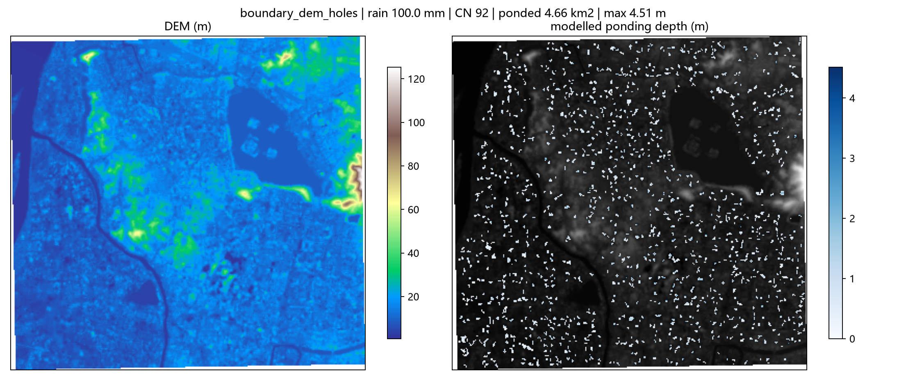

# Event report: boundary_dem_holes

- outcome: **ok**
- domain: 321 x 341 cells, 67.17 km2, 28.1 m grid
- rainfall: 100.0 mm, mean CN 92
- runoff: mean 78.4 mm, coefficient 0.784
- ponding: 4.662 km2, max depth 4.51 m, basins 1302

## Machine-checkable indicators

| indicator | value | tolerance | passed |
|---|---|---|---|
| D01_water_balance | 0.0000 | 0.0100 | True |
| D01b_raster_vs_solver | 0.0000 | 0.0000 | True |
| D04_sensitivity | 0.2897 | 0.4500 | True |

## Input quality

- [warning] DEM_HOLES: DEM has 14.74% missing cells (largest contiguous hole: 1369 cells); holes are treated as open drains.
- [info] WATER_MASK: Excluded 7.620 km2 of permanent water surface from the ponding analysis.

## 图

### 诊断图（DEM 与水深）



## 产物清单

| 文件 | 大小 | 说明 |
|---|---|---|
| `boundary_dem_holes_report.json` | 0.12 MB | 机器可判指标的完整数值；本报告与交互页面的唯一数据来源 |
| `boundary_dem_holes_report.md` | 0.00 MB | 本文件 |
| `boundary_dem_holes_depth.tif` | 0.04 MB | 逐格淹没深度栅格（GeoTIFF，EPSG:32650，LZW 压缩） |
| `boundary_dem_holes_map.png` | 1.26 MB | 诊断图（DEM + 水深），调试用 |

共 4 个产物文件。

## 复算

```
python -X utf8 -m floodkit run --bounds 118.7184 32.0188 118.8214 32.1015 --rain-mm 100 --cn 92 --cn-source uniform --tag boundary_dem_holes
```

指标数值取自 `boundary_dem_holes_report.json`；本页每个数字都由该文件生成，未手工录入。
