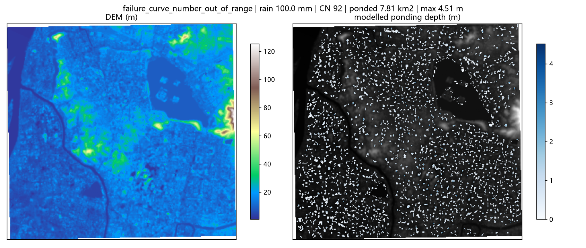

# Event report: failure_curve_number_out_of_range

- outcome: **ok**
- domain: 321 x 341 cells, 76.32 km2, 28.1 m grid
- rainfall: 100.0 mm, mean CN 92
- runoff: mean 78.5 mm, coefficient 0.785
- ponding: 7.810 km2, max depth 4.51 m, basins 2320

## Machine-checkable indicators

| indicator | value | tolerance | passed |
|---|---|---|---|
| D01_water_balance | 0.0000 | 0.0100 | True |
| D01b_raster_vs_solver | 0.0000 | 0.0000 | True |
| D04_sensitivity | 0.3004 | 0.4500 | True |

## Input quality

- [warning] DEM_HOLES: DEM has 3.08% missing cells (largest contiguous hole: 919 cells); holes are treated as open drains.
- [info] WATER_MASK: Excluded 7.614 km2 of permanent water surface from the ponding analysis.

