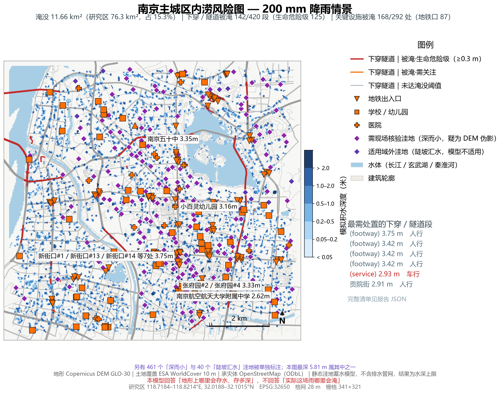
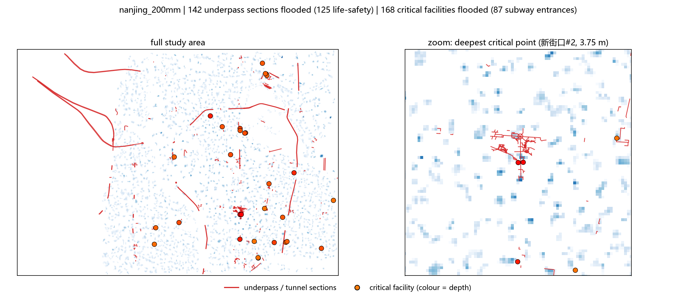
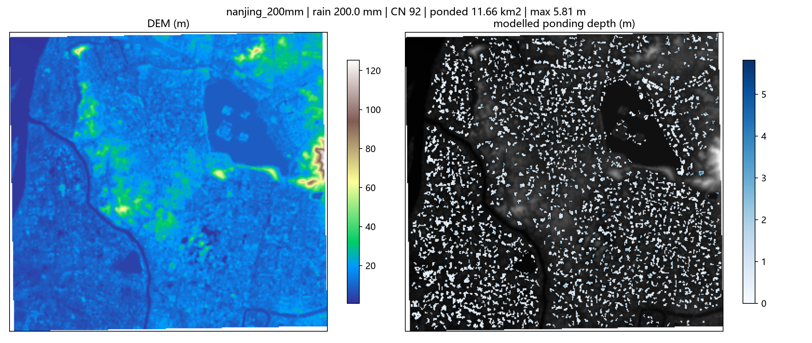

# Event report: nanjing_200mm

- outcome: **ok**
- domain: 321 x 341 cells, 76.32 km2, 28.1 m grid
- rainfall: 200.0 mm, mean CN 92
- runoff: mean 173.9 mm, coefficient 0.870
- ponding: 11.663 km2, max depth 5.81 m, basins 2320

## Machine-checkable indicators

| indicator | value | tolerance | passed |
|---|---|---|---|
| D01_water_balance | 0.0000 | 0.0100 | True |
| D01b_raster_vs_solver | 0.0000 | 0.0000 | True |
| D04_sensitivity | 0.1675 | 0.4500 | True |

## Input quality

- [warning] DEM_HOLES: DEM has 3.08% missing cells (largest contiguous hole: 919 cells); holes are treated as open drains.
- [info] WATER_MASK: Excluded 7.614 km2 of permanent water surface from the ponding analysis.

## Exposure (OpenStreetMap)

### 下穿通道与隧道（生命危险级）

- 下穿/隧道段共 420 段，被淹 **142 段**，其中生命危险级（水深 ≥0.3 m）**125 段**

| 名称 | 类型 | layer | 淹没长度 (m) | 最大水深 (m) | 风险 |
|---|---|---|---|---|---|
| (unnamed) | footway | -1 | 2 | 3.75 | life-safety |
| (unnamed) | footway | -1 | 5 | 3.42 | life-safety |
| (unnamed) | footway | -1 | 1 | 3.42 | life-safety |
| (unnamed) | footway | -1 | 1 | 3.42 | life-safety |
| (unnamed) | service | -1 | 3 | 2.93 | life-safety |
| 贡院街 | pedestrian | -1 | 3 | 2.91 | life-safety |
| 黄家圩路 | secondary | -1 | 1 | 2.87 | life-safety |
| (unnamed) | footway | -1 | 1 | 2.78 | life-safety |
| 红山南路 | secondary | -1 | 3 | 2.58 | life-safety |
| 红山南路 | secondary | -1 | 2 | 2.58 | life-safety |

### 关键设施（地铁口 / 医院 / 学校 / 消防）

- 设施共 292 个，被淹 **168 个**；其中**地铁口被淹 87 个**
- 被淹分类：subway_entrance 87 个，school 59 个，hospital 18 个，kindergarten 3 个，fire_station 1 个

| 类型 | 名称 | 水深 (m) |
|---|---|---|
| subway_entrance | 新街口#2 | 3.75 |
| subway_entrance | 新街口#13 | 3.75 |
| school | 南京五十中 | 3.35 |
| subway_entrance | 张府园#4 | 3.33 |
| kindergarten | 小百灵幼儿园 | 3.16 |
| hospital | 四五四医院 | 2.86 |
| subway_entrance | (unnamed) | 2.78 |
| subway_entrance | 莫愁湖#2 | 2.66 |
| school | 南京大学附属中学 | 2.66 |
| school | 南京航空航天大学附属中学 | 2.62 |

### 路网与建筑

- road ways flooded: 2076 / 4751, flooded length 6306 m of 39458 m
- buildings affected: 1579 / 12080 (13.1%), footprint 892576 m2

| road | type | flooded length (m) | max depth (m) |
|---|---|---|---|
| 集庆门大街 | secondary | 32 | 1.88 |
| 集庆门大街 | secondary | 24 | 1.88 |
| 汉中门大街 | primary | 24 | 2.17 |
| 江东中路 | primary | 23 | 0.85 |
| 水西门大街 | primary | 23 | 2.39 |
| 江东中路 | primary | 22 | 2.50 |
| (unnamed) | primary | 22 | 1.93 |
| 水西门大街 | primary | 22 | 1.67 |
| 红山南路 | secondary | 22 | 1.64 |
| (unnamed) | service | 22 | 4.45 |

## 图

### 报告级风险地图（OpenStreetMap 底图 + 分级水深 + 风险点位）



### 下穿隧道与关键设施风险点位



### 诊断图（DEM 与水深）



## 产物清单

| 文件 | 大小 | 说明 |
|---|---|---|
| `nanjing_200mm_report.json` | 0.17 MB | 机器可判指标的完整数值；本报告与交互页面的唯一数据来源 |
| `nanjing_200mm_report.md` | 0.00 MB | 本文件 |
| `nanjing_200mm_depth.tif` | 0.08 MB | 逐格淹没深度栅格（GeoTIFF，EPSG:32650，LZW 压缩） |
| `nanjing_200mm_report_map.png` | 1.86 MB | 报告级风险地图（PNG） |
| `nanjing_200mm_report_map.pdf` | 1.07 MB | 同上，矢量、字体内嵌，可印刷放大 |
| `nanjing_200mm_critical.png` | 0.50 MB | 风险点位图（下穿 / 设施） |
| `nanjing_200mm_map.png` | 1.49 MB | 诊断图（DEM + 水深），调试用 |
| `nanjing_200mm_report.html` | 1.80 MB | 单文件离线交互式报告（双击打开，无需联网） |
| `nanjing_200mm_ponding.geojson` | 3.05 MB | 水深分级多边形，可直接拖进 QGIS / ArcGIS |
| `nanjing_200mm_exposure.geojson` | 1.64 MB | 承灾体矢量：下穿段、关键设施、淹没道路、受影响建筑 |

共 10 个产物文件。

## 复算

```
python -X utf8 -m floodkit run --bounds 118.7184 32.0188 118.8214 32.1015 --rain-mm 200 --cn 92 --cn-source landcover --tag nanjing_200mm --exposure
```

指标数值取自 `nanjing_200mm_report.json`；本页每个数字都由该文件生成，未手工录入。
