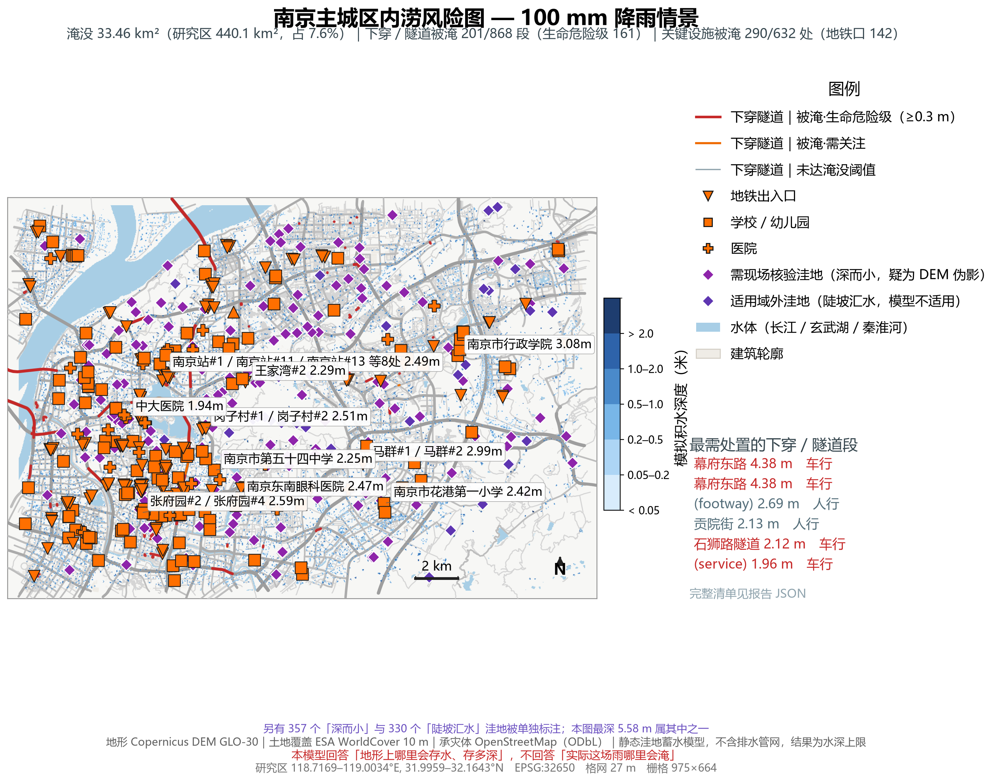
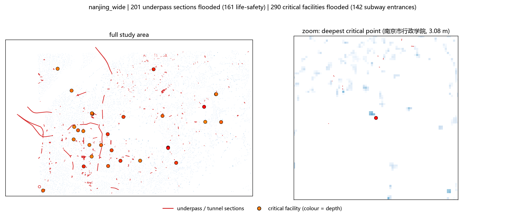
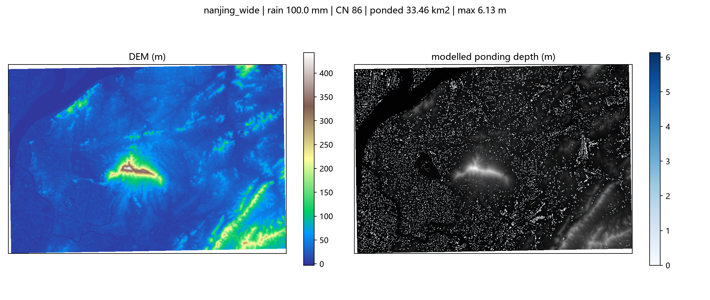

# Event report: nanjing_wide

- outcome: **degraded**
- domain: 664 x 975 cells, 440.13 km2, 27.4 m grid
- rainfall: 100.0 mm, mean CN 86
- runoff: mean 63.6 mm, coefficient 0.636
- ponding: 33.464 km2, max depth 6.13 m, basins 9323

## Machine-checkable indicators

| indicator | value | tolerance | passed |
|---|---|---|---|
| D01_water_balance | 0.0000 | 0.0100 | True |
| D01b_raster_vs_solver | 0.0000 | 0.0000 | True |
| D04_sensitivity | 0.3010 | 0.4500 | True |
| D02_checkpoint_hit_rate | 0.1111 | 0.7000 | False |

## Input quality

- [warning] DEM_HOLES: DEM has 3.66% missing cells (largest contiguous hole: 8286 cells); holes are treated as open drains.
- [info] WATER_MASK: Excluded 29.242 km2 of permanent water surface from the ponding analysis.

## Exposure (OpenStreetMap)

### 下穿通道与隧道（生命危险级）

- 下穿/隧道段共 868 段，被淹 **201 段**，其中生命危险级（水深 ≥0.3 m）**161 段**

| 名称 | 类型 | layer | 淹没长度 (m) | 最大水深 (m) | 风险 |
|---|---|---|---|---|---|
| 幕府东路 | trunk | -1 | 7 | 4.38 | life-safety |
| 幕府东路 | trunk | -1 | 7 | 4.38 | life-safety |
| (unnamed) | footway | -1 | 3 | 2.69 | life-safety |
| 贡院街 | pedestrian | -1 | 2 | 2.13 | life-safety |
| 石狮路隧道 | secondary | -1 | 3 | 2.12 | life-safety |
| (unnamed) | service | -1 | 1 | 1.96 | life-safety |
| (unnamed) | footway | -1 | 1 | 1.93 | life-safety |
| (unnamed) | footway | -1 | 1 | 1.93 | life-safety |
| (unnamed) | footway | -1 | 1 | 1.93 | life-safety |
| (unnamed) | footway | -1 | 0 | 1.93 | life-safety |

### 关键设施（地铁口 / 医院 / 学校 / 消防）

- 设施共 632 个，被淹 **290 个**；其中**地铁口被淹 142 个**
- 被淹分类：subway_entrance 142 个，school 113 个，hospital 26 个，kindergarten 8 个，fire_station 1 个

| 类型 | 名称 | 水深 (m) |
|---|---|---|
| school | 南京市行政学院 | 3.08 |
| subway_entrance | 马群#1 | 2.99 |
| subway_entrance | 马群#2 | 2.99 |
| subway_entrance | (unnamed) | 2.67 |
| subway_entrance | 张府园#4 | 2.59 |
| subway_entrance | 岗子村#2 | 2.51 |
| subway_entrance | 南京站#11 | 2.49 |
| subway_entrance | 南京站#5 | 2.49 |
| hospital | 南京东南眼科医院 | 2.47 |
| school | 南京市花港第一小学 | 2.42 |

### 路网与建筑

- road ways flooded: 6026 / 18587, flooded length 15027 m of 171174 m
- buildings affected: 3036 / 36291 (8.4%), footprint 1687765 m2

| road | type | flooded length (m) | max depth (m) |
|---|---|---|---|
| 恒通大道 | secondary | 34 | 1.49 |
| 燕山路 | tertiary | 30 | 1.34 |
| 江东中路 | primary | 30 | 1.41 |
| 幕府东路 | secondary | 27 | 4.38 |
| 江东中路 | primary | 27 | 1.98 |
| 和燕路 | primary | 25 | 1.91 |
| 和燕路 | primary | 25 | 1.91 |
| (unnamed) | primary | 24 | 1.87 |
| 恒飞路 | secondary | 24 | 1.05 |
| 天华东路 | secondary | 24 | 0.65 |

## 图

### 报告级风险地图（OpenStreetMap 底图 + 分级水深 + 风险点位）



### 负结果：官方易涝点核对（ROC / 水深分布 / 点位）


### 下穿隧道与关键设施风险点位



### 诊断图（DEM 与水深）



## 产物清单

| 文件 | 大小 | 说明 |
|---|---|---|
| `nanjing_wide_report.json` | 0.18 MB | 机器可判指标的完整数值；本报告与交互页面的唯一数据来源 |
| `nanjing_wide_report.md` | 0.01 MB | 本文件 |
| `nanjing_wide_depth.tif` | 0.28 MB | 逐格淹没深度栅格（GeoTIFF，EPSG:32650，LZW 压缩） |
| `nanjing_wide_report_map.png` | 2.09 MB | 报告级风险地图（PNG） |
| `nanjing_wide_report_map.pdf` | 3.90 MB | 同上，矢量、字体内嵌，可印刷放大 |
| `nanjing_wide_negative_result.png` | 0.60 MB | 官方易涝点核对的负结果图（ROC / 分布 / 点位） |
| `nanjing_wide_negative_result.pdf` | 0.22 MB | 同上，矢量、字体内嵌 |
| `nanjing_wide_negative_result.json` | 0.00 MB | 负结果图上的每个数字，及其与报告的逐位对账结果 |
| `nanjing_wide_critical.png` | 0.44 MB | 风险点位图（下穿 / 设施） |
| `nanjing_wide_map.png` | 1.17 MB | 诊断图（DEM + 水深），调试用 |
| `nanjing_wide_report.html` | 6.35 MB | 单文件离线交互式报告（双击打开，无需联网） |
| `nanjing_wide_ponding.geojson` | 9.65 MB | 水深分级多边形，可直接拖进 QGIS / ArcGIS |
| `nanjing_wide_exposure.geojson` | 4.25 MB | 承灾体矢量：下穿段、关键设施、淹没道路、受影响建筑 |

共 13 个产物文件。

## 复算

```
python -X utf8 -m floodkit run --bounds 118.7169 31.9959 119.0034 32.1643 --rain-mm 100 --cn 86 --cn-source landcover --tag nanjing_wide --exposure
```

指标数值取自 `nanjing_wide_report.json`；本页每个数字都由该文件生成，未手工录入。
