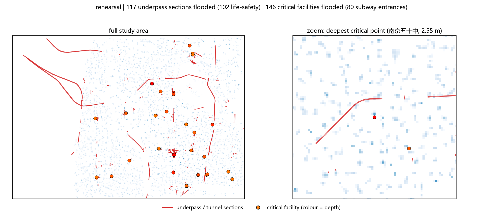
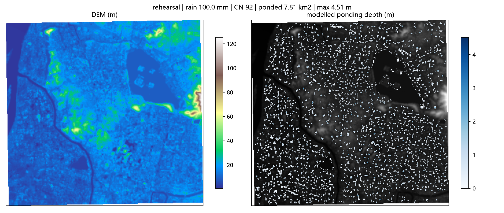

# Event report: rehearsal

- outcome: **ok**
- domain: 321 x 341 cells, 76.32 km2, 28.1 m grid
- rainfall: 100.0 mm, mean CN 92
- runoff: mean 78.5 mm, coefficient 0.785
- ponding: 7.810 km2, max depth 4.51 m, basins 2320

## Machine-checkable indicators

| indicator | value | tolerance | passed |
|---|---|---|---|
| D01_water_balance | 0.0000 | 0.0100 | True |
| D01b_raster_vs_solver | 0.0000 | 0.0000 | True |
| D04_sensitivity | 0.3004 | 0.4500 | True |

## Input quality

- [warning] DEM_HOLES: DEM has 3.08% missing cells (largest contiguous hole: 919 cells); holes are treated as open drains.
- [info] WATER_MASK: Excluded 7.614 km2 of permanent water surface from the ponding analysis.

## Exposure (OpenStreetMap)

### 下穿通道与隧道（生命危险级）

- 下穿/隧道段共 420 段，被淹 **117 段**，其中生命危险级（水深 ≥0.3 m）**102 段**

| 名称 | 类型 | layer | 淹没长度 (m) | 最大水深 (m) | 风险 |
|---|---|---|---|---|---|
| (unnamed) | footway | -1 | 2 | 2.47 | life-safety |
| (unnamed) | footway | -1 | 1 | 2.19 | life-safety |
| 黄家圩路 | secondary | -1 | 1 | 2.06 | life-safety |
| (unnamed) | service | -1 | 1 | 1.81 | life-safety |
| (unnamed) | footway | -1 | 4 | 1.76 | life-safety |
| (unnamed) | footway | -1 | 1 | 1.76 | life-safety |
| (unnamed) | footway | -1 | 1 | 1.76 | life-safety |
| (unnamed) | pedestrian | -1 | 2 | 1.64 | life-safety |
| (unnamed) | pedestrian | -1 | 2 | 1.64 | life-safety |
| (unnamed) | footway | -1 | 1 | 1.64 | life-safety |

### 关键设施（地铁口 / 医院 / 学校 / 消防）

- 设施共 292 个，被淹 **146 个**；其中**地铁口被淹 80 个**
- 被淹分类：subway_entrance 80 个，school 49 个，hospital 15 个，kindergarten 2 个

| 类型 | 名称 | 水深 (m) |
|---|---|---|
| school | 南京五十中 | 2.55 |
| subway_entrance | 新街口#2 | 2.47 |
| subway_entrance | 新街口#13 | 2.47 |
| subway_entrance | 张府园#4 | 2.23 |
| subway_entrance | (unnamed) | 2.19 |
| kindergarten | 小百灵幼儿园 | 2.15 |
| subway_entrance | (unnamed) | 1.91 |
| hospital | 四五四医院 | 1.86 |
| school | 南京市第六十六中学 | 1.82 |
| school | 南京大学附属中学 | 1.80 |

### 路网与建筑

- road ways flooded: 1722 / 4751, flooded length 4173 m of 39458 m
- buildings affected: 1131 / 12080 (9.4%), footprint 586364 m2

| road | type | flooded length (m) | max depth (m) |
|---|---|---|---|
| 集庆门大街 | secondary | 24 | 1.19 |
| 集庆门大街 | secondary | 20 | 1.19 |
| 水西门大街 | primary | 20 | 1.85 |
| 汉中门大街 | primary | 17 | 1.42 |
| (unnamed) | primary | 16 | 1.32 |
| 江东中路 | primary | 15 | 2.00 |
| 江东中路 | primary | 15 | 0.56 |
| 虎踞路 | primary | 15 | 2.94 |
| 察哈尔路 | secondary | 15 | 1.36 |
| 水西门大街 | primary | 14 | 1.15 |

## 图

### 下穿隧道与关键设施风险点位



### 诊断图（DEM 与水深）



## 产物清单

| 文件 | 大小 | 说明 |
|---|---|---|
| `rehearsal_report.json` | 0.17 MB | 机器可判指标的完整数值；本报告与交互页面的唯一数据来源 |
| `rehearsal_report.md` | 0.00 MB | 本文件 |
| `rehearsal_depth.tif` | 0.06 MB | 逐格淹没深度栅格（GeoTIFF，EPSG:32650，LZW 压缩） |
| `rehearsal_critical.png` | 0.41 MB | 风险点位图（下穿 / 设施） |
| `rehearsal_map.png` | 1.40 MB | 诊断图（DEM + 水深），调试用 |
| `rehearsal_report.html` | 1.79 MB | 单文件离线交互式报告（双击打开，无需联网） |

共 6 个产物文件。

## 复算

```
python -X utf8 -m floodkit run --bounds 118.7184 32.0188 118.8214 32.1015 --rain-mm 100 --cn 92 --cn-source landcover --tag rehearsal --exposure
```

指标数值取自 `rehearsal_report.json`；本页每个数字都由该文件生成，未手工录入。
